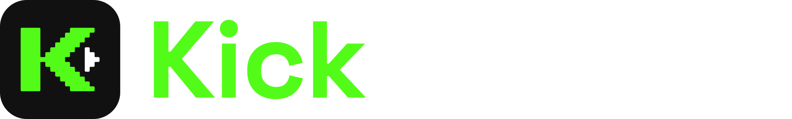

<p align="center">
  <picture>
    <source media="(prefers-color-scheme: light)" srcset="Resources/brand/lockup-light.svg">
    
  </picture>
</p>

<p align="center">
  A native Kick client for iPhone and iPad. Live streams, VODs, clips and chat in a fast SwiftUI app.
</p>

<p align="center">
  
  
  
  
  <a href="https://discord.gg/gNgrNhrQYU"></a>
</p>

---

KickUnblock is an ad-free, open-source Kick viewer. It uses the same Amazon IVS
player as Kick for livestreams. It uses Apple's player for VODs and clips. It keeps your follows
and saved clips on your device. No account is needed to watch.

## Install

Add the **IsmaelTech's iPAs** source to your favorite signer app or download `KickUnblock.ipa` from [Releases](../../releases) and sign it with your own certificate.

<p align="center">
  <a href="https://repo.ismaeltech.dev/add.html?app=altstore"></a>
  <a href="https://repo.ismaeltech.dev/add.html?app=sidestore"></a>
  <a href="https://repo.ismaeltech.dev/add.html?app=feather"></a>
  <a href="https://repo.ismaeltech.dev/add.html?app=ryuksign"></a>
  <a href="https://repo.ismaeltech.dev/add.html?app=flarestore"></a>
</p>

You can also add the source URL manually.

```text
https://repo.ismaeltech.dev/repo.json
```

## Features

- None of the ads and analytics frameworks in Kick's app. That's MediaTailorSDK (7.77 MB), ProgrammaticAccessLibrary (15.8 MB), OMSDK_Amazon2 (380 KB), DzMediaTailorAdapter (212 KB), DzBase (9.90 MB), MuxCore (510 KB) and DzAmazonIVSPlayerAdapter (129 KB). That adds up to 34.7 MB of junk you don't get.
- Rewind any live stream to the start and jump back with Go to LIVE.
- Picture in Picture, background audio, AirPlay and a mini player you can browse with.
- A sleep timer for streams, VODs and clips.
- Download VODs to Files and save clips to Photos.
- 7TV emotes in chat with overlay emotes drawn on top. BTTV and FFZ are optional.
- 7TV emote changes show up live as you watch.
- 7TV badges and name colors are on by default.
- Block words or people right from chat.
- Chat history loads when you join with no duplicate messages.
- Chat replay plays along with VODs.
- Fullscreen chat as a column, an overlay or hidden.
- Animated emotes pause in Low Power Mode and when your phone gets hot.
- Hide mature streams, bot commands, repeated messages and sub alerts.
- Follows and saved clips stay on your device. Import your follows from Kick.
- Sign in with Kick on kick.com's own page to chat and see your Drops progress.
- Carbon and Pure Black themes with accent colors and seven app icons.
- Tweaks for chat size, quality, skip length, the opening screen and more.

## Known issues

- Watching here does not earn crate rewards.
- Watching here might not count toward Drops or level badges.
- The Amazon IVS player sends playback quality data to Amazon.
- Ads baked into a broadcast can still show.

## Repository layout

```text
App/            SwiftUI app: player, chat, browsing, account, tweaks
Sources/        KickUnblockCore, the platform-neutral Swift package (models, parsing, policy)
Config/         Info.plist and privacy manifest
Resources/      Brand assets and app icon sources
Scripts/        Build, packaging and SDK fetch helpers
.github/        IPA build workflow and issue templates
project.yml     XcodeGen project definition
build-mac.sh    Unsigned IPA build
```

## Releases

Public testing starts at **1.0 (0)** with tag `v1.0-build0`. Tester fixes increment the
build number to 1, 2 and onward. The version stays 1.0.

## Build it yourself

You need macOS, Xcode with the iOS SDK, Swift and Python 3.

```bash
bash build-mac.sh
```

This fetches the pinned Amazon IVS SDK and XcodeGen, builds Release for iOS and writes
an unsigned, verified IPA to `build/unsigned/release/`.

## Documentation

- [Privacy](PRIVACY.md), [Support](SUPPORT.md) and [Security](SECURITY.md)
- [Changelog](CHANGELOG.md)

## Credits

Inspired by [TwitchUnblock](https://github.com/MXFia19/TwitchUnblock) by MXFia19. No code
was copied. KickUnblock is written from scratch for Kick.

Live playback uses the public [Amazon IVS Player SDK](https://docs.aws.amazon.com/ivs/latest/LowLatencyUserGuide/player.html).
The wordmark is set in Space Grotesk (SIL Open Font License 1.1).

## Disclaimer

KickUnblock is not affiliated with Kick in any shape or form.

## License

Project code is [MIT](LICENSE). Third-party SDKs keep their own licenses. Kick is a
trademark of its owner.
